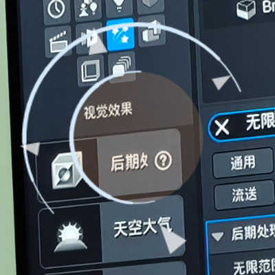
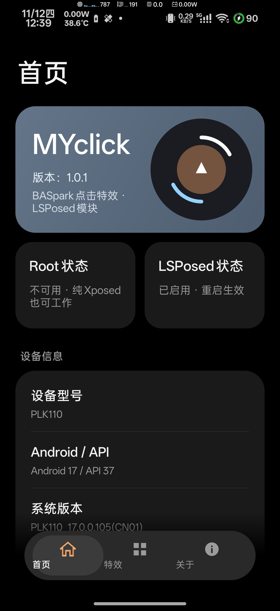
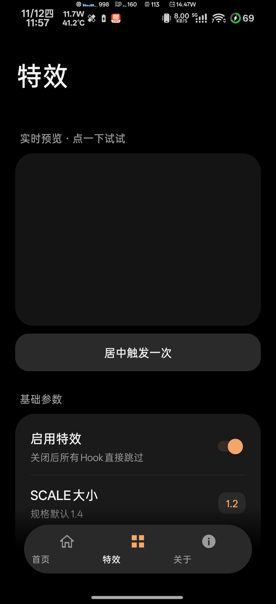
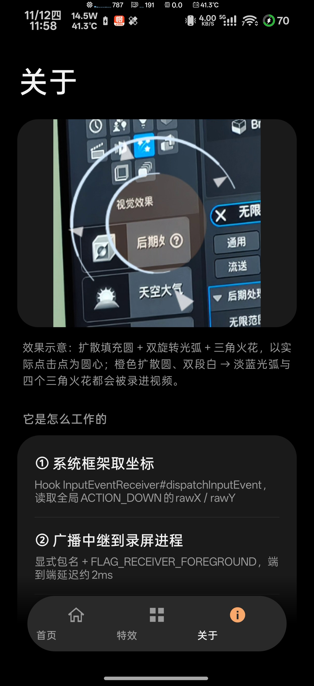
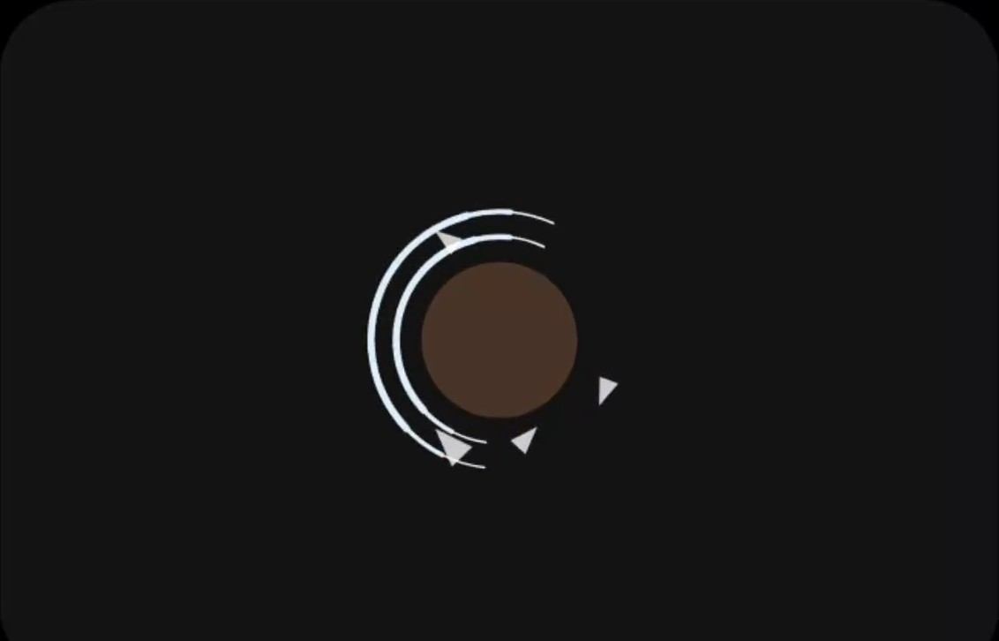
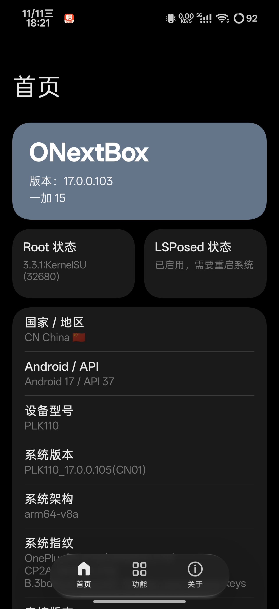

<div align="center">

# ✦ MYclick

**把 ColorOS / 一加「屏幕录制」里那个朴素的白色圆点，<br/>换成会扩散、会旋转、会迸出火花的点击特效**

[](https://github.com/mingyu0401/MYclick/releases)
[](#-兼容性)
[](#-快速开始)
[](#-从源码构建)
[](LICENSE)

[📦 下载 Release APK](https://github.com/mingyu0401/MYclick/releases/latest) ·
[🚀 快速开始](#-快速开始) ·
[🐛 提交 Issue](https://github.com/mingyu0401/MYclick/issues)

<br/>



*效果示意 · 橙色扩散填充圆 + 双旋转光弧 + 三角火花，以实际点击点为圆心*

</div>

---

## ✨ 它做了什么

原版 ColorOS 屏录的「记录屏幕点击」，本质是打开 AOSP 的 `show_touches`，
由 `system_server` 在合成层画一个白点。MYclick 把这个白点关掉，
用一层**透明、不可触摸、能被 MediaProjection 捕获**的覆盖层重画一遍：

| | |
| :--- | :--- |
| 🎯 **全屏真实坐标** | 从系统框架的 `InputEventReceiver#dispatchInputEvent` 取全局 `ACTION_DOWN`，点任何 App 都有特效，不消费事件 |
| 🎬 **真的录得进去** | `TYPE_APPLICATION_OVERLAY` + 透明 `SurfaceView`，走 SurfaceFlinger 合成链；**不设 `FLAG_SECURE`**，也**绝不往 AUTO_MIRROR 虚拟屏加窗口** |
| ⚡ **60fps 零分配** | `Choreographer` 驱动、粒子对象池 + swap-remove、`Paint`/`Path` 复用、`dt` 钳 50ms，无粒子立即停帧清屏 |
| 🎨 **完全可配** | SCALE、动画速度、深浅主题、8 项调色板、目标包名、触摸来源、全局生效开关，改完即时广播生效 |
| 📱 **自动识别录屏 App** | 打开设置页即探测本机真实安装的屏幕录制包名并自动填入目标包名，换机 / 换 ROM 无需手填 |

---

## 📸 效果

<div align="center">

| 效果示意 | 真机录屏抽帧（非合成图） |
| :---: | :---: |
|  |  |
| 规格参考 | 橙色扩散圆 + 双段白→淡蓝光弧 + 三角火花 |

</div>

动画规格 1:1 还原：16 帧 ease-out-cubic 扩散圆（`26 × SCALE`）、
23 帧双光弧（各 `1.1π`、10 段变线宽、白 → 淡蓝/粉）、4 个三角火花（摩擦 0.9、每帧 -0.032 alpha），
逻辑坐标用 dp，DPR 上限 2x。设置页里的「实时预览」跑的就是同一套 `EffectEngine`。

<details>
<summary><b>点开看完整规格对照表</b></summary>

| 规格 | 实现 |
| --- | --- |
| 扩散圆 0 → `26 × SCALE`（默认 1.4），266ms / 16 帧 | `EffectEngine.BASE_RADIUS` / `CIRCLE_FRAMES`，`ease = 1-(1-p)³` |
| 填充 alpha 0.4 → 0 | `fillAlpha = 0.4*(1-cp)*255` |
| 双光弧各 `1.1π`，随机起始偏移 / 角速度 `[0, 0.08, 0.1]` | `ARC_SPAN` / `ROT_SPEEDS` |
| 弧半径按 `[0,1,1.5,2] × SCALE` 向外扩张，383ms / 23 帧 | `SPREAD_RATES` / `ARC_FRAMES` |
| 线宽 `weight(t)=min(2-|4(t-0.5)|,1)`，0.4 → 3.3，分 10 段 | `MIN_WIDTH/MAX_WIDTH` / `ARC_SEGMENTS` |
| 白 `(250,252,252)` → 淡蓝 `(150,210,255)` / 粉 `(224,79,124)` | `Palette.arcStart/arcEnd` 线性插值 |
| 4 个三角火花，初速 `4.8~6.8 × SCALE`，摩擦 ×0.9 | `SPARKS_PER_TAP` / `FRICTION` |
| 深色圆 `rgba(249,168,108)`、浅色圆 `rgba(224,122,63)` | `Config.dark*` / `Config.light*`，设置页可改 |

</details>

---

## 📦 下载

| 渠道 | 文件 |
| --- | --- |
| **GitHub Releases**（推荐） | [MYclick-1.0.2-release.apk](https://github.com/mingyu0401/MYclick/releases/latest) |
| 仓库内直链 | [download/MYclick-1.0.2-release.apk](https://github.com/mingyu0401/MYclick/raw/main/download/MYclick-1.0.2-release.apk) |

> **测试与日常使用统一使用 release 包**（复用 debug 签名，可直接覆盖安装）。
> 当前版本 **v1.0.2**；v1.0.0 / v1.0.1 保留为历史版本，`latest` 已指向 v1.0.2。
> SHA-256：`7a5a1394e86f2298b5ddfc699400e27b7239cb383fc76a352448ccc52213ab05`

---

## 🚀 快速开始

<details open>
<summary><b>① 安装</b></summary>

```bash
adb install -r download/MYclick-1.0.2-release.apk
adb shell pm list packages -s | grep -i screenrecord   # 确认录屏包名
```

</details>

<details open>
<summary><b>② 在 LSPosed 里启用并勾选作用域</b>（最关键的一步）</summary>

打开 **LSPosed 管理器 → 模块 → MYclick**，启用后勾选：

- ✅ `com.oplus.screenrecorder`（屏幕录制；**目标包名会自动识别为本机真实安装的录屏 App**，其它分支可在「关于」页重新探测）
- ✅ **系统框架 / System Framework (`android`)** ← 全屏点击坐标全靠它
- ✅ 部分版本还会单列 `system`，一并勾上

> 只勾选录屏 App 是**不会有全屏特效**的——录屏进程本身收不到别的窗口的触摸事件。

已 root 且装了 `lspctl`，也可以命令行完成（真机验证走的就是这条路径）：

```bash
adb shell su -c 'lspctl module enable --user=0 com.myclick'
adb shell su -c 'lspctl scope set --user=0 com.myclick android system com.oplus.screenrecorder'
```

</details>

<details open>
<summary><b>③ 重启 → 打开设置页 → 开始录屏</b></summary>

1. **重启手机**（Hook 系统框架必须重启；软重启 `kill system_server` 也可以，无线调试会短暂断开）。
   只更新覆盖层代码时不必重启整机，`adb shell am force-stop com.oplus.screenrecorder` 即可重新加载。
   **「全局生效」的宿主在 system_server 里，模块 APK 升级后必须重启系统框架才会加载新代码。**
2. 打开 MYclick 设置页，在「特效」页点一下预览区确认动画，按需要调 SCALE / 调色板。
3. 用系统快捷磁贴开始录屏，随便点几下，停止后回看视频。建议同时在录屏设置里打开「记录屏幕点击」——
   它写 `show_touches=1` 是最可靠的「录制开始」信号，本模块会把它钳回 0 以隐藏原生白点。

</details>

排障日志：

```bash
adb logcat -s LSPosed:V MYclick:V Xposed:V
adb shell settings get system show_touches     # 录屏中应为 0
```

ColorOS 会过滤普通 App 的 `android.util.Log`，**优先看 LSPosed 管理器 → 日志 → 模块日志**。

---

## 🧭 设置页

三页底部胶囊导航，深色卡片式排布，避免一长条列表：

| 页 | 内容 |
| --- | --- |
| **首页** | 版本主卡、Root / LSPosed 状态双卡、设备信息、常用开关（含「全局生效」）、一键推送配置 |
| **特效** | 实时预览（点一下就出特效）、SCALE / 速度 / 主题 / 触摸来源 / 全局生效、深浅两套调色板 |
| **关于** | 效果示意图、目标包名（自动识别）与重新探测、工具与仓库链接、排障速查 |

<div align="center">

| 首页 | 特效 | 关于 |
| :---: | :---: | :---: |
|  |  |  |

*真机截图 · 一加 PLK110 / Android 17 / ColorOS 17 · v1.0.2 release 包*

底部导航带滑动高亮胶囊：切页时旧页淡出横移、新页淡入，图标弹性缩放、文字颜色渐变；
主卡右侧图标与 App 启动图标共用同一个矢量资源，圆形裁切后自然融入卡片。

</div>

「特效」页的预览区与录屏覆盖层共用同一套 `EffectEngine`，点一下就能看到动画（下图为录屏抽帧）：

<div align="center">

</div>

<details>
<summary>设计参考</summary>

设置页的视觉语言（纯黑底、石板蓝主卡、`#1A1A1A` 分组卡、大标题、底部胶囊导航）参考了
ONextBox 的深色卡片式布局，仅作样式参考：



</details>

---

## 🛠 从源码构建

```bash
# JDK 17+ / Android SDK platform android-36 / build-tools 36+
export ANDROID_HOME=/path/to/Android/Sdk     # Windows 可写 local.properties
./gradlew :app:assembleRelease --offline
# 产物：app/build/outputs/apk/release/app-release.apk
```

- AGP 9.4.1 **内置 Kotlin 2.2.0**，不要再 apply `org.jetbrains.kotlin.android`；
  `kotlin-stdlib` 版本必须与内置编译器一致。
- `app/libs/xposed-api-82.jar` 是 **compileOnly** 桩，运行时由 LSPosed 提供，
  已验证 APK 内不含 `de/robv/android/xposed/**` 类。
- 混淆默认关闭（`gradle.properties` 的 `myclick.enableMinify=false`），
  置 `true` 即启用 `proguard-rules.pro`（Hook 入口、反射目标、配置字段均已 keep）。
- release 复用 debug 签名，**可直接安装**，不用自己配 keystore。
- 无 AndroidX / 无第三方运行时依赖，整包约 2.3 MB。

---

## ⚙️ 配置项

| 项 | 默认 | 说明 |
| --- | --- | --- |
| 启用特效 | 开 | 热路径实时读取，改后不必重启 |
| SCALE / 动画速度 | 1.4 / 1.0 | 范围 0.5~3.0 / 0.3~3.0 |
| 主题 | 跟随系统 | 可强制深色 / 浅色 |
| 触摸事件来源 | 自动 | 自动 / 仅系统框架 / 仅应用作用域 / 仅录屏进程本地 |
| **全局生效** | **关** | 默认只在录屏时显示；打开后**不录屏也出特效**，由 system_server 里的覆盖层直接绘制，不依赖录屏 App 进程是否在运行。⚠️ 全局显示可能会厌烦，慎重打开（开启前二次确认）。旧版「显示时机 → 始终显示」自动迁移到此开关 |
| 隐藏原生圆点 / DPR 上限 2x | 开 / 开 | 钳 `show_touches=0`；关闭 DPR 上限按真实 density 渲染 |
| 目标 / 附加包名 | 自动识别本机录屏包 | 打开设置页即探测并自动填入；可手动覆盖 / 重新探测 |
| 调色板 8 项 | 见规格表 | 深色 / 浅色各 4 个 `#RRGGBB` |

---

## ✅ 真机验证

设备：**一加 PLK110 / Android 17 / ColorOS 17 / KernelSU / LSPosed 2.2.1**，
录屏 App `17.5.4`（targetSdk 37）。用 `adb shell screenrecord` 与 ColorOS 原生录屏两条通道分别录制，
`ffprobe` 看帧数、抽帧统计亮度与点击点附近的时域帧差，再放大逐帧核对：

| 项目 | 结果 |
| --- | --- |
| 特效入镜 | 橙色扩散圆、双段白→淡蓝光弧、4 个三角火花全部录进视频，且以实际点击点为圆心 |
| 全黑问题 | 修复前 154s 录制只有 **7 帧视频**（音频 7216 帧）；修复后 29.1s/**973 帧**、6.6s/**497 帧**、4.6s/**370 帧**，全程非黑 |
| 窗口归属 | 录屏期间 `dumpsys window` 只有 `mDisplayId=0` 的一个 `MYclick-FX` 窗口 |
| 时序 | `ACTION_DOWN → relay（约 2ms）→ overlay`，单次点击只出一次特效，无重影 |
| 对齐 | 红色十字标记比对，特效中心与点击点重合，约 154px 的 Y 偏移已消除 |
| 设置页 UI 回归 | 2026-11-12 装上 `download/` 里的 release 包逐页截图：三页布局正常、示意图完整显示；修掉 Android 15+ 强制 edge-to-edge 导致的状态栏文字重叠、底部内容从导航下透出；实时预览抽帧可见扩散圆、双段光弧、4 个三角火花 |
| release 包录屏回归 | 同日 ColorOS 原生录屏 **105s / 1317 帧**（HEVC 1080×2354），全程非黑（桌面段 122/156/157、深色页 40/35/30）；4 次点击全部中继成功（`sink=true`、`active=true`），抽帧可见扩散圆、双段淡蓝光弧、4 个三角火花；`dumpsys window` 仍只有 `displayId=0` 一个 `MYclick-FX` |
| v1.0.1 UI 回归 | 装上 `MYclick-1.0.1-release.apk`（versionCode 2）逐页截图：版本号 1.0.1、主卡图标与启动图标一致、底栏文字垂直居中；录屏抽帧确认高亮胶囊质心 `48 → 105 → 162` **连续过渡**（非瞬移），页面淡入淡出生效；目标包名自动识别为本机真实安装的 `com.oplus.screenrecorder` |
| 全局生效默认值 | 覆盖安装后冷启动设置页，root 读取模块 SP 确认 `globalEffect=false`（默认关闭）、`gateMode=0` |
| 全局生效修复回归 | 2026-11-12：ColorOS 会拦截 system_server 发往普通 App 静态接收器的广播（框架侧 `global sent` 有、App 侧 `recv` 为 0），改为**在 system_server 同进程挂载覆盖层**、ACTION_DOWN 经 TouchBus 直连。软重启后日志 `[android] 全局生效宿主已挂载`，三次点击均有 `global direct` + `overlay onTouch globalHost=true attached=true`；窗口由 `uid=1000 / package=android` 持有；**非录屏状态**短录屏抽帧可见白 → 淡蓝双段光弧 |
| v1.0.2 叠画修复 | 打开「全局生效」后再开录屏，用户真机确认每次点击只出一份特效。根因是录屏 App 常驻后台时错过了配置推送，快照里 `globalEffect` 仍为 `false`，一开录两套窗口就各画一份；现由 system_server 随每次 `ACTION_DOWN` 下发 `globalOwned` 归属标记，录屏进程收到即让位，归属信息跟着事件走、不再依赖配置同步 |

<details>
<summary><b>排障速查表</b></summary>

| 现象 | 原因 / 处理 |
| --- | --- |
| 完全没有特效 | 多半只勾了录屏 App、没勾「系统框架」，或没重启。看模块日志里 `[android] 系统框架触摸源已安装` |
| 日志里什么都没有 | ColorOS 过滤普通 App 的 `android.util.Log`；改看 LSPosed 模块日志。灭屏 / Dozing 时本来就没有输入事件 |
| 只有点悬浮球才有特效 | 系统框架 Hook 未生效 |
| 特效比点击慢半拍 | 隐式广播被放进延迟队列（实测约 500ms）；确认 `setPackage` + `FLAG_RECEIVER_FOREGROUND` |
| 一次点击画两遍 | `HookGate` 进程级一次性安装 + 40ms/16px 去重；检查是否把额外 App 勾进作用域 |
| 录屏全黑 / 只有几帧（音频正常） | 覆盖层误挂到 AUTO_MIRROR 虚拟屏。`dumpsys window windows \| grep MYclick-FX` 应只有 `mDisplayId=0` 一个；升级后 `am force-stop com.oplus.screenrecorder` |
| 特效出现但录屏里没有 | 检查是否被加 `FLAG_SECURE`（本模块不加）、是否用了「仅录制单个 App」模式 |
| 特效位置偏移 | 窗口 inset；当前用 `setFitInsetsTypes(0)` + `getLocationOnScreen()` 补偿 |
| 原生白点还在 | `hideNativeDot` 未生效；`adb shell settings put system show_touches 0` 临时验证 |

</details>

---

## 📁 目录结构

```
MYclick/
├── download/                       # 可直接安装的 release APK（测试统一用这个）
├── docs/images/                    # 效果示意图、设置页三页真机截图、预览抽帧与录屏验证帧
├── app/
│   ├── build.gradle.kts            # compileOnly Xposed API，不打包进 APK
│   ├── libs/xposed-api-82.jar      # 随工程交付，离线可构建
│   ├── proguard-rules.pro
│   └── src/main/
│       ├── AndroidManifest.xml     # xposedmodule / xposedminversion=93 / xposedscope
│       ├── assets/xposed_init      # com.myclick.HookEntry
│       ├── res/                    # 深色主题、导航图标、效果示意图
│       └── java/com/myclick/
│           ├── HookEntry.kt                 # LSPosed 入口，运行时动态判定作用域
│           ├── bridge/                     # HookBridge / XposedBridgeImpl
│           ├── core/                       # Config / Prefs / Provider / TouchRelay / 状态与诊断
│           ├── fx/                         # EffectEngine / EffectSurfaceView
│           ├── hook/                       # 框架 Hook / 录屏运行时 / 中继 / HookGate
│           ├── overlay/                    # 悬浮窗 + 虚拟屏过滤 + 多显示器
│           └── ui/                         # SettingsActivity / UiKit / 颜色选择 / 底栏切换动画
├── LICENSE
└── README.md
```

---

## 📄 许可与说明

[Apache-2.0](LICENSE)。本项目是个人设备增强用途的 LSPosed 模块，
**不含原厂 APK 的任何代码或资源**；逆向结论仅用于定位 Hook 点。

Hook 系统框架只在 `before` 阶段读事件、不改参数，出错全部吞掉；
仍建议先备份数据、熟悉自己设备的救砖流程再折腾。
